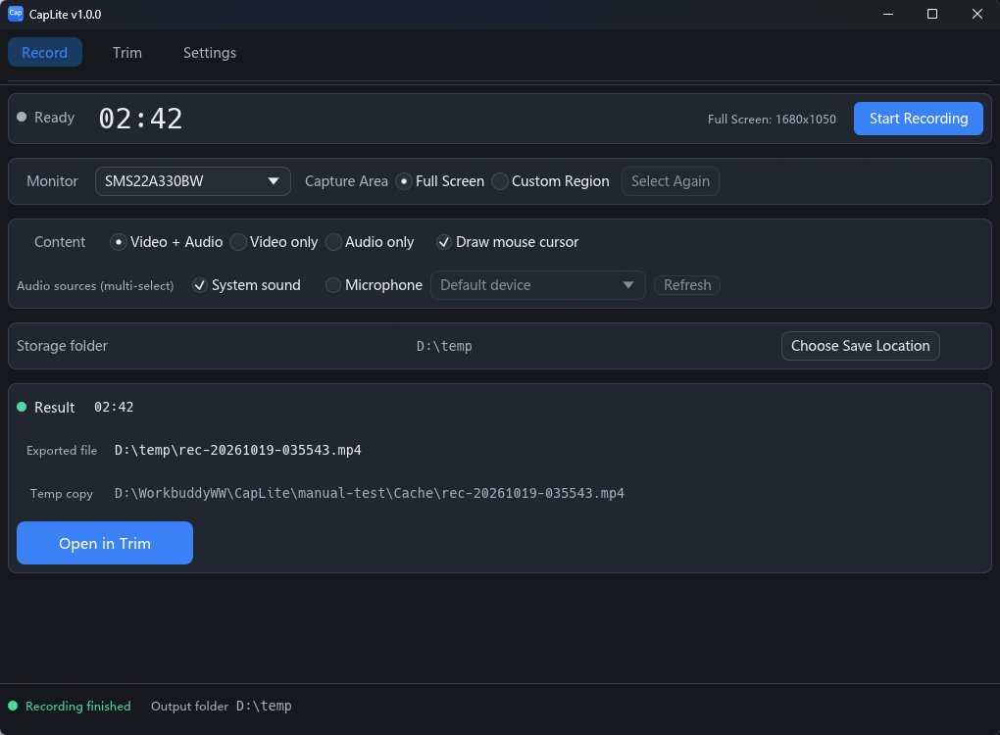
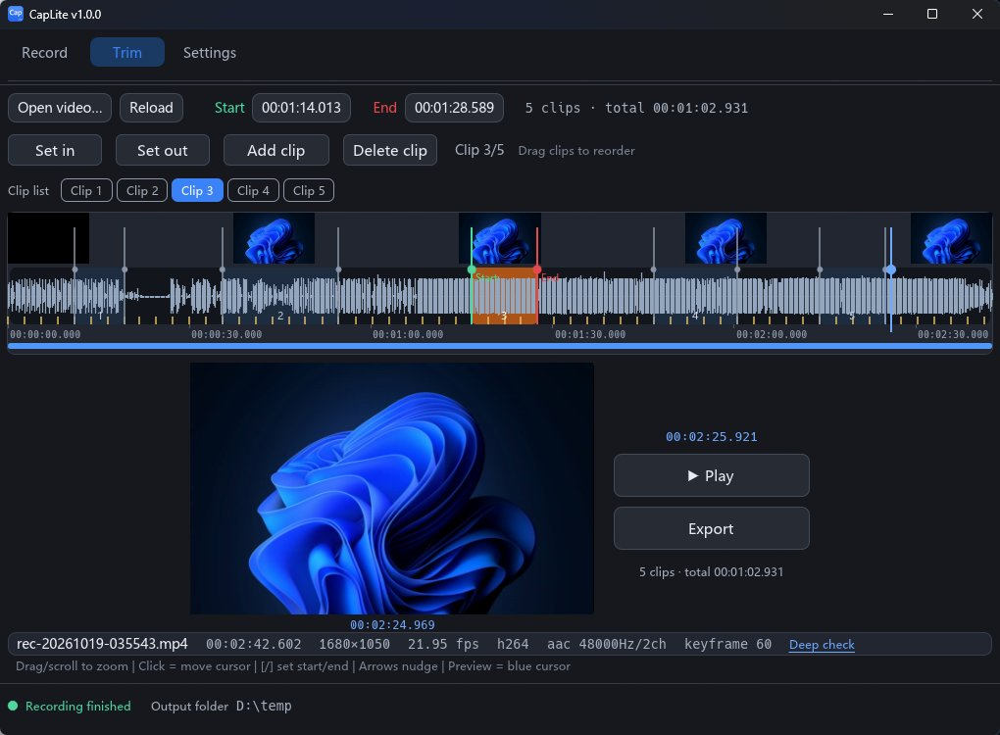
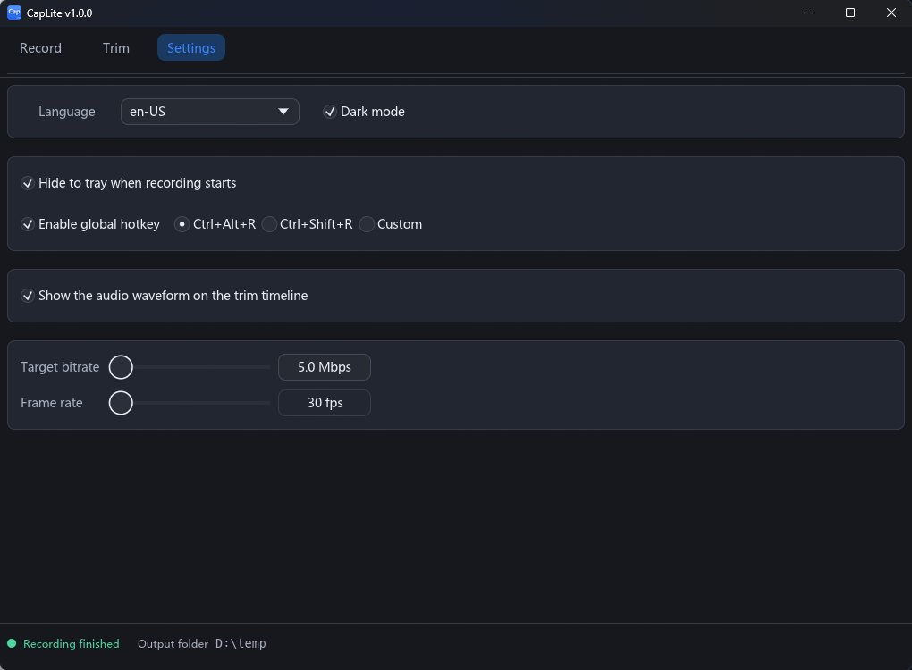

# CapLite 1.0.2

**CapLite** is a lightweight, green-install (no installer) screen recorder and clipper for
Windows x64. It records the screen — a whole monitor or a region you drag out — together
with system audio and/or microphone, encodes H.264 with OpenH264, and writes a fragmented
MP4 *while* recording so an interrupted session is still playable.

It then lets you trim that recording on a timeline and export a lossless cut.

The user interface is built with Rust + `egui`/`eframe`. FFmpeg is used only for AAC
encoding, MP4 muxing/remuxing, and decoding frames/audio for the editor's preview,
waveform and thumbnails.


> **开发记录**：[WORK_SUMMARY_2026-10-19.md](WORK_SUMMARY_2026-10-19.md)（最新 · 项目收尾）· [2026-10-18](WORK_SUMMARY_2026-10-18.md) · [工作日志.md](工作日志.md)（结算口径 + 进度封存点，原《进度日志》已并入）· [docs/IMPLEMENTATION_2026-10-19.md](docs/IMPLEMENTATION_2026-10-19.md)（本轮安全/稳定/占用实现的验证记录）· [docs/SECURITY_STABILITY_AUDIT_2026-10-19.md](docs/SECURITY_STABILITY_AUDIT_2026-10-19.md)（第二轮安全/稳定性复审，含 6 个 P0）· [docs/CLEANUP_2026-10-19.md](docs/CLEANUP_2026-10-19.md)（目录清理记录）· [docs/IMPLEMENTATION_2026-10-19_BATCH2.md](docs/IMPLEMENTATION_2026-10-19_BATCH2.md)（P0-1~4 + 第二批修复记录）· [docs/OPTIMIZATION_BACKLOG_2026-10-19.md](docs/OPTIMIZATION_BACKLOG_2026-10-19.md)（第三轮剩余优化空间）· [docs/RELEASE_LAYOUT.md](docs/RELEASE_LAYOUT.md)（发布包固定布局规则）· [docs/PENDING.md](docs/PENDING.md)

---

## Features

### Recording

* **Full-screen or region recording** — pick a monitor, or drag out a region on screen.
* **H.264 encoding via OpenH264** — software encoding, so no GPU or driver requirements.
* **System audio + microphone** — WASAPI loopback capture plus an optional microphone,
  mixed into a single AAC-LC stream. The audio path is **read/write split**: each source's
  capture thread only memcpy's into a two-stage SPSC ring buffer (200 ms small + 10 s large),
  so no slowdown on the encode/mux side can ever overrun the WASAPI device buffer (the
  unrecoverable "pops and gaps" failure mode). Audio threads run above the video threads in
  priority — if the machine is overloaded, frames are dropped, never audio. WASAPI source
  outages are detected and healed: device-invalidation errors (`AUDCLNT_E_*`, e.g. switching
  the default output device) automatically rebuild the capture session (up to 3 times), so
  recording continues instead of failing.
* **Fragmented MP4 written while recording** — video and audio are flushed incrementally,
  so a crash leaves recoverable data in `Cache\` instead of an unplayable half-written file.
* **Plain MP4 export on stop** — the fragmented stream is remuxed (stream copy, no
  re-encode) into an ordinary `.mp4` in your output folder. Start, stop and finalization
  run on background workers: the window stays responsive (showing `Starting…` /
  `Exporting…`) even when OpenH264 initialization or `+faststart` takes a long time.
* **Visible session problems** — if capture/encoding/audio fails mid-session, or a
  recording thread panics, the result carries a warning instead of being reported as a
  clean success. Export can still finish, but the UI says the recording ended early.

### Editing

* **Keyframe-snapped lossless export** — select a range and export it with bitstream copy.
  Cuts snap to the nearest keyframe, so no picture is ever re-encoded.
* **Multi-segment merge** — mark an in/out point and hit **Add clip** to collect that range;
  collect as many as you like, then export them as **one** continuous file (`xxx-merged.mp4`).
  The clip list is a **playlist, not a time slicing**: order *is* playback order, so you can
  **drag a chip left or right to reorder** the merge, and overlapping or repeated ranges are
  legal. Chips are numbered and show each range's start–end; the film strip shades every
  range in place (the selected one brighter) and the total merged duration is shown next to
  the export button. Segments are joined on a single microsecond timeline with stream copy
  only, so there is no re-encode and no A/V drift at the joins. Cuts still snap to keyframes
  (in point snaps right, out point snaps left) — with no clip in the list, export falls back
  to the plain single-range path.
* **Playback with a frame-accurate clock** — a green **Play / Stop** button sits directly
  below the timecode of the current frame; the space bar toggles the same action. Decoding
  runs on its own thread and is throttled against the wall clock, so the timecode stays true
  even when frames are dropped. While playing, the thumbnail strip **pages**: once the
  playhead reaches the right edge the view flips left by one page. Clicking the timeline or
  stepping with the arrow keys **does not interrupt playback** — the clock simply re-anchors
  to the new position. Zooming the timeline or touching the position row **does** stop
  playback (the playhead stays where it was).
* **Playback with sound** — a parallel `clip-audio-play` thread decodes the file's audio
  track (AAC → 48 kHz stereo), resamples it, and renders it to the default output device.
  The audio chain **fails silently into mute, never into an error**: a file with no audio
  track or an unavailable output device just means you hear nothing while the picture keeps
  playing. Seeking sends the same timestamp to both chains at once. (A/V sync is
  best-effort: both chains run in real time from the same start point; a dedicated
  master-clock sync engine is planned, not built.)
* **The current frame moves only when you click the film** — clicking the strip, the waveform
  lane or the timecode row is the one mouse gesture that repositions the playhead (dragging
  its blue handle counts as pressing the film). Zooming the timeline and dragging/clicking the
  position row **never** touch it: zoom only changes the viewport around the pointer, and the
  position row is now a plain scrollbar. The viewport also no longer follows (or centres on)
  the current frame — it only moves when *you* move it, or when playback pages past the edge.
* **Audio waveform** — computed **after** the video has been imported (the first decoded
  preview frame and the first thumbnail tile must be on screen), so opening a file shows
  pictures first and never stalls on audio. The whole-file base layer is then filled in by
  **four worker threads** working on 8-minute segments, and the segment under the current
  viewport is always computed **first** — pan or zoom and the newly visible segment jumps the
  queue. Zooming in further switches to a dense per-tile layer.
* **Opening never freezes the window** — opening a file only *probes* the container on a
  background thread and hands the clip to the UI as soon as stream info is known, so the
  first frame appears immediately; the **keyframe index is built afterwards** in the same
  background thread (Export stays disabled with a "Building keyframe index…" hint until it
  is complete, because a stream-copy export must start on a keyframe). Long recordings that
  used to block the UI for seconds now open instantly.
* **Broken-block detection** — the same whole-file pass that builds the keyframe index also
  checks the file for **encoding damage** (reads that end before the container says they
  should, timestamp jumps, a video stream with no keyframes), so it costs **no extra disk
  I/O**. Damaged ranges are drawn as a band along the bottom of the waveform lane
  (red = the data really is unusable, amber = only a warning) and listed on hover in the
  file-info row. **Playback automatically jumps over** the red ranges instead of stalling or
  showing green blocks, and **Export cuts them out by default** and says so
  ("Skipped about N s of broken data") — a stream-copy export that started on a non-keyframe
  used to produce a garbled first GOP. A **Deep check** link runs a full decode in the
  background (cancellable, with progress) to catch corruption that a demuxer pass cannot see.
  A clean file produces zero bands and zero behaviour change.
* **Thumbnail strip** — the visible range is covered by **five** evenly spaced thumbnail
  tiles that follow the timeline (they do *not* scale with zoom), plus a single
  full-size thumbnail of the keyframe nearest the playhead.
* **Zoom anchored at the pointer** — the mouse wheel zooms the timeline around the cursor
  position (1.1×–1.25× per notch) instead of around the middle, and the view can be panned
  with the position row or a right-drag.
* **Position row** — a full-length overview row shows where the current viewport sits in
  the whole clip. It is a **scrollbar**: drag it and the visible band follows the pointer in
  the same direction, click it to bring the clicked spot to the middle of the viewport.
  It does not move the current frame, and touching it stops playback.

### Shell

* **Hide to tray while recording** — **off by default** (privacy: a hotkey-started
  recording stays visible). Turn it on explicitly; the tray menu offers *Show window*,
  *Stop recording* and *Exit*, and the tray icon/tooltip shows recording state.
* **Global hotkey, `Ctrl+Alt+R` by default** — one key press toggles start/stop recording
  from anywhere. `Ctrl+Shift+R` and a custom combination are also available.
* **Bilingual UI (English / Chinese), English by default.**

## The three pages

### Record



Choose the monitor, **Full Screen** or **Custom Region**, content mode
(Video+Audio / Video only / Audio only), cursor, system sound and/or microphone,
and the storage folder; then press **Start Recording**. The Result card shows the
exported file, the retained Cache copy, and **Open in Trim**.

### Trim



Open a recording, set **Start/End** (or **Set in/Set out**), add/delete/reorder clips,
and use the waveform to navigate (`[` / `]`, arrow keys, drag/scroll to zoom). **Play**
previews; **Export** writes one lossless, keyframe-snapped MP4 without re-encoding.
**Deep check** is available for damaged files.

### Settings



Language, dark mode, **Hide to tray when recording starts**, global hotkey,
**Show the audio waveform**, target bitrate and frame rate. Changes save
automatically.

The Settings screenshot shows “Hide to tray” enabled for illustration; the current
default is **off** so a hotkey-started recording stays visible.

## System requirements

* **Windows 10 or Windows 11, x64.**
* **Universal C Runtime (UCRT)** — part of Windows 10/11, nothing to install. CapLite.exe
  is built with the MSVC toolchain and links the UCRT dynamically.
* **Microsoft Visual C++ 2015–2022 Redistributable (x64)** — supplies `VCRUNTIME140.dll`
  and `VCRUNTIME140_1.dll`, which `CapLite.exe` and the bundled `openh264*.dll` import.
  Unlike the UCRT these are **not** part of a clean Windows installation; most machines
  already have them because other software installs them. If CapLite refuses to start with
  "VCRUNTIME140.dll was not found", install the redistributable from Microsoft.
* DXGI Desktop Duplication is used for capture and WASAPI for audio; both are included
  with the supported Windows versions above.

To **build from source** you additionally need Rust (stable, MSVC toolchain), Visual Studio
Build Tools with the Windows SDK, and an FFmpeg **LGPLv3 shared** development package
(`FFMPEG_DIR` must point at it).

The released ZIP needs none of that — it ships its own DLLs.

## Install and run

CapLite is portable. Extract `CapLite-1.0.2-win64.zip` anywhere and run `CapLite.exe`;
keep the `runtime\` folder next to it (it contains the 7 required DLLs). There is no
installer and no registry state. Uninstall = delete the extracted folder.

Only **one instance** runs at a time. Starting CapLite again restores/activates the
existing window and exits the second process; this prevents two instances from fighting
over the same configuration, cache fragments and global hotkey.

Recording needs at least **512 MB free** on both the cache and output volumes. CapLite
checks this before starting and every few seconds while recording, and stops cleanly
(with a visible warning) instead of filling the disk. While recording it also keeps the
system awake and stops cleanly on lock, suspend, or a display-mode change; recording is
not resumed automatically on unlock.

On first launch Windows SmartScreen may intervene — see
[First run: Windows SmartScreen](#first-run-windows-smartscreen).

## Build and run

The build environment is driven by `_build-env.bat` (normal) or `_build-env-san.bat`
(sandbox-safe, no `vcvars64.bat`). Both use `%~dp0`, so they build **the copy they live
in**, set `FFMPEG_DIR`/`LIBCLANG_PATH` to that copy's bundled tools, and forward their
arguments to `cargo`.

```powershell
# Build the release GUI (the helper sets MSVC/FFmpeg/LLVM env, then runs cargo):
.\_build-env-san.bat build --release --bin CapLite

# Convenient debug path: build + dev-sign + launch
powershell -NoProfile -ExecutionPolicy Bypass -File scripts\run-dev.ps1
```

Manual equivalents (run from a shell where the helper has exported the env, or prefix
each with `_build-env-san.bat`):

```powershell
cargo build --all-targets                  # everything (lib + bins + tests), must be warning-free
cargo build --release --bin CapLite        # release build -> <target>\release\CapLite.exe
cargo test -- --test-threads=1             # unit + e2e + doc tests (serial)
powershell -NoProfile -ExecutionPolicy Bypass -File scripts\regression.ps1   # 12 end-to-end checks
```

`scripts\regression.ps1` exercises the real recording/export pipeline: it starts the
program, records short clips, and cross-checks the output with the bundled
`ffmpeg`/`ffprobe` CLI. Its FFmpeg CLI comes from `$env:FFMPEG_TOOLS_DIR`; override it with
`-ToolsDir` if you keep the CLI elsewhere. It prints `12/12 PASS` and exits `0` when the
build is healthy.

**Build hygiene on this machine.** Use `_build-env.bat` (it sets `CARGO_INCREMENTAL=0`), and note
that `[profile.dev]` pins `debug = 1`. Every `cargo test` / `cargo build` deletes the previous
generation of intermediates — `target\debug\incremental\**` (~1 000 `.o` + ~1 000 `.pre-lto.bc`
per session; the tree measured 762 MB / 31 dirs) and one `tmp*.temp-archive` per linked binary
under `target\<profile>\deps\rustc*\`. On this machine a delete is **redirected to the Recycle
Bin**, so each run leaves a fresh batch of `target\…` files there, and the disk space is not
released until the bin is emptied. Turning incremental compilation off removes that source
entirely; emptying the Recycle Bin is what actually frees the space.

The icon is generated (not hand-drawn); see [Regenerating the icon](#regenerating-the-icon).

## Repository layout

| Path | What it is |
| --- | --- |
| `src/` | The Rust crate: `main.rs` (app shell + logging), `lib.rs`, `config.rs`, `i18n.rs`, `sys.rs` (thread priorities), `recorder.rs` (session orchestration), plus `audio/` (`capture`/`ring`/`mixer`/`aac`), `video/` (`capture`/`cursor`/`convert`/`encode`/`openh264`), `mux/`, `edit/` (`player` = playback video decode, `audio_out` = playback audio decode + render, `waveform` = peak analysis), `ui/` (`main_page`/`editor`/`settings`/`startup`/`theme`/`layout`), and `bin/` (standalone smoke/probe tools). |
| `scripts/` | `run-dev.ps1` (build → dev-sign → launch), `regression.ps1` (12 end-to-end checks), `dev-sign.ps1` (self-signed dev signature + Mark-of-the-Web removal), `build-ffmpeg-min.ps1` (reproduces the bundled minimal FFmpeg build), `make-icon.py` (generates the app icon), `startup-compare.ps1` / `opt-measure.ps1` (startup measurements), `make-font-subset.*` (UI font subsetting). |
| `docs/` | `DESIGN.md` (full design record and measurements), `PENDING.md` (issue log and per-round verification record) and `DEV-SIGNING.md` (development signing notes). |
| `assets/` | `caplite.ico` (multi-size application icon), `caplite-256.png` (preview), subset UI font. |
| `ffmpeg-min/` | The project-built **minimal LGPLv3 shared** FFmpeg (5 DLLs, 4 546 048 B). The 5 DLLs in the release package come from `ffmpeg-min\bin\`. |
| `tests/` | End-to-end tests (`e2e.rs`) driving the real mux/export code. |
| `native/` | Prebuilt native bits used at link time: `yuv.lib` (libyuv), `openh264.dll`, the CRT stub source and bindgen stubs. |
| `locales/` | UI translations, embedded into the executable at compile time: `en-US.json` (default) and `zh-CN.json`. |
| `dist/` | Release assemblies and the packaged ZIP. |

## Where files go

### Output (your recordings)

The configured output folder; its default is the user's **Videos** folder. If that folder
cannot be written, CapLite falls back to
`%USERPROFILE%\Videos\cap` → `%USERPROFILE%\Documents\cap` → `<exe folder>\cap-recordings`
→ the system temporary folder, and tells you which one it ended up using.

### Cache (intermediate fragments)

While recording, the fragmented intermediate stream is written to
**`Cache\recordings\`**:
`<exe folder>\Cache` if it is writable, otherwise `<config folder>\Cache`, otherwise
`%TEMP%\CapLite\Cache`.

CapLite **never deletes recording fragments on its own**. If the folder still holds files
when you close the app, it warns you once and shows the full path so you can clean it up
yourself.

`Cache\derived\` holds **regenerable** data (waveform peak caches). Unlike recordings, this
can be pruned automatically: at startup CapLite keeps at most 64 files and removes anything
older than 30 days. Loss of a derived file only means the waveform is computed again.

### Logs

The release build has no console window. It writes its startup/diagnostic log to
**`cap.log` in the configuration directory**. The configuration directory is resolved in
this order:

1. `--config-dir <folder>` / `--config-dir=<folder>` if you passed it on the command line,
2. `%USERPROFILE%\Documents\cap\` (the normal location),
3. `<folder containing CapLite.exe>\cap-recordings\` if the above is not writable,
4. `%TEMP%\cap-recordings\` as a last resort.

`--config-dir` is the only command-line option; it is handy for a throwaway
"fresh install" run. `config.json` lives in the same folder as `cap.log`; the previous
good copy is kept as `config.json.bak` and is used automatically if the main file is
damaged. `cap.log` is rotated to `cap.log.1` at 2 MB (one backup kept); absolute drive
paths and UNC paths are redacted before writing.

Release builds also install a `tracing` file sink at `WARN` level, so failures from the
recording/audio/export pipeline (not just startup marks) land in `cap.log`. Set
`RUST_LOG=info` (or `debug`) before launching for a more verbose session.

## Known limitations

* **The bundled FFmpeg decodes only H.264 and AAC.** The minimal build is configured with
  `--enable-decoder=h264 --enable-decoder=aac` precisely to keep the download at ~4.5 MB.
  Media that uses **HEVC/H.265, AV1, VP9 or any other codec therefore cannot be previewed,
  thumbnailed or waveform-analysed** in the editor — the editor needs to decode frames.
  (Recording is unaffected: CapLite always *encodes* H.264/AAC itself.) Replacing the five
  FFmpeg DLLs with a fuller LGPLv3 build of the same names restores those codecs.
* **Viewports wider than 120 s use the whole-file base layer.** Waveform and thumbnail
  refinement only kick in when the visible range is at most 120 seconds; zoomed further
  out you see the coarse, whole-file layer. This is a deliberate memory/CPU trade-off.
* **No GPU encoding.** Video is encoded in software with OpenH264, so a fast CPU matters
  more than a fast GPU. Hardware encoders (NVENC/QSV/AMF) are not used.
* **Playback decodes at preview size.** Frames are decoded at the on-screen frame size, so a
  maximised window costs more than the same clip in a small window; the timecode stays
  correct by dropping frames rather than by slowing down. Seeking while playing is throttled
  to 120 ms, so a fast drag catches up in small hops and lands exactly on the target when you
  let go.
* **Overlapping clips look identical on the film strip.** Each clip's range is shaded in
  place, so two clips covering the same span draw on top of each other — only the numbered
  chips above tell them apart. Very long clip lists also wrap onto a second chip row, which
  needs a slightly taller window.

## First run: Windows SmartScreen

The released binary is signed with a **development** certificate, not a commercial
code-signing certificate, so Windows SmartScreen may show
*"Windows protected your PC"* the first time you run it.

Click **More info** → **Run anyway**. (You can verify the signature yourself with
`Get-AuthenticodeSignature .\CapLite.exe`.)

## Tray icon and global hotkey

CapLite does not have to stay in your way while it records.

### Hiding to the tray

**Settings → General → "Hide to tray when recording starts"** is **off by default**.
This is deliberate: a recording started by the global hotkey must not make the window
disappear silently. If you enable it, the main window hides on start and only the window
that CapLite itself hid is restored later — if you had already minimised it yourself, the
app leaves it alone.

The tray icon has a right-click menu with three entries:

| Menu entry | What it does |
| --- | --- |
| **Show window** | Restores and focuses the main window. |
| **Stop recording** | Same as pressing the main button: stops capture and runs the normal export/finalise path. This is the easy way back when the window is hidden. |
| **Exit** | Stops any running recording (with the normal finalise/export), then closes the app. |

While recording, the tray icon shows a **red recording dot** and its tooltip shows elapsed
time; starting/stopping also posts a brief visible notice.

If the tray icon cannot be installed (for example an Explorer/notification-area problem),
CapLite logs a warning and keeps working normally — only the icon and its menu are missing,
recording and the global hotkey are unaffected. The window is then never hidden, so you can
still see and stop the recording.

### Global hotkey

**Settings → General → Global hotkey** registers a system-wide shortcut so you can start and
stop recording without focusing the window. One key press **toggles**: not recording → start,
recording → stop. It uses exactly the same code path as the main button, so the export and
error handling are identical.

The setting offers three choices:

| Choice | Shortcut |
| --- | --- |
| **Ctrl+Alt+R** | The default. |
| **Ctrl+Shift+R** | The alternative preset. |
| **Custom** | Click the field and press your own combination. |

Rules and failure behaviour:

* A custom combination must contain at least one modifier (`Ctrl` / `Alt` / `Shift` / `Win`)
  **and** one normal key (for example `R` or `F9`).
* Windows-reserved combinations (for example `Ctrl+Alt+Del`) are rejected outright.
* If the combination is **already taken by another program**, CapLite says so in the status bar
  **and suggests a free alternative** it found by probing candidates — pick that, or press a
  different combination. Your text is kept as typed so you can edit it rather than retype it.
* If the custom text cannot be parsed, the app falls back to `Ctrl+Alt+R` and tells you which
  shortcut is actually in use, so you are never left guessing why a key does nothing.
* Turning the option off simply does not register anything; it does not delete your choice.

The hotkey and the tray menu labels follow the UI language. The shortcut works whether the
window is visible, minimised or hidden to the tray.

## Language

The interface ships in **English (default)** and **Chinese**, selected in
**Settings → General → Language**. Both locale files live in `locales/` and are compiled
into `CapLite.exe`, so switching language needs no extra files.

The minimum supported window size is **760×671** logical pixels
(`ui::layout::MIN_INNER_W` × `MIN_INNER_H`, which is the single source of truth); all three
pages fit without scrolling at that size.

## Dependencies and licensing

CapLite itself is **MIT** licensed — see [`LICENSE`](LICENSE).

Third-party components:

| Component | License | How it is used |
| --- | --- | --- |
| **FFmpeg 9.0.2** (`avcodec-63` / `avformat-63` / `avutil-61` / `swresample-7` / `swscale-10`) | **LGPLv3+** | **Dynamically linked** DLLs shipped in `runtime\` next to `CapLite.exe`. They can be replaced with your own builds of the same names. |
| **OpenH264** (`openh264.dll`, `openh264-7.dll`) | BSD-2-Clause (Cisco) + Cisco binary license | H.264 software encoding, loaded at runtime. |
| **libyuv** | BSD-3-Clause (Google) | Colour conversion, linked statically. |
| **Rust crates** (from crates.io) | MIT / Apache-2.0 (a few BSD-3-Clause / ISC / Zlib / Unicode-3.0) | Statically linked into `CapLite.exe`. |

**This program contains no GPL components.** The bundled FFmpeg is the project's own
minimal LGPL configuration (`--disable-avdevice --disable-avfilter`, no `--enable-gpl`,
no `--enable-nonfree`), and it is only ever used through its DLLs.

The full third-party component list, the FFmpeg source/`configure` details and the license
texts are in [`THIRD-PARTY-NOTICES.txt`](THIRD-PARTY-NOTICES.txt), and ship inside the
release package as `THIRD-PARTY-NOTICES.txt`, `LICENSE-FFmpeg.txt` and
`LICENSE-OpenH264.txt`. The design record has more detail in `docs/DESIGN.md` §11.19.

## Regenerating the icon

`assets/caplite.ico` and `assets/caplite-256.png` are produced by
[`scripts/make-icon.py`](scripts/make-icon.py) (Python + Pillow only, no network access):

```powershell
python scripts\make-icon.py            # skips existing files
python scripts\make-icon.py --force    # always rewrite
```

It draws a blue rounded square (`#3B82F6` → `#2563EB`, the latter being the UI accent
colour) with a white bold "Cap" and exports a multi-size ICO
(16/24/32/48/64/128/256). A dim "Lite" is drawn in the bottom-right corner **only at
sizes ≥ 64 px**, because at 16 px it would only add noise. `build.rs` then compiles that
ICO into a `.res` with the MSVC `rc.exe` from the Windows SDK and hands it to the linker,
so the icon is embedded in `CapLite.exe`; if `rc.exe` is unavailable the build warns and
continues without an icon.

## Uninstalling

CapLite is portable: **uninstall = delete the extracted folder.** Nothing is written to the
registry.

Two folders are deliberately left behind, because they hold data you may still want:

* the configuration folder (`%USERPROFILE%\Documents\cap\` by default, containing
  `config.json` and `cap.log`),
* any `Cache\` folder that still holds intermediate fragments, and the recordings you saved.

Delete them yourself when you no longer need them.
